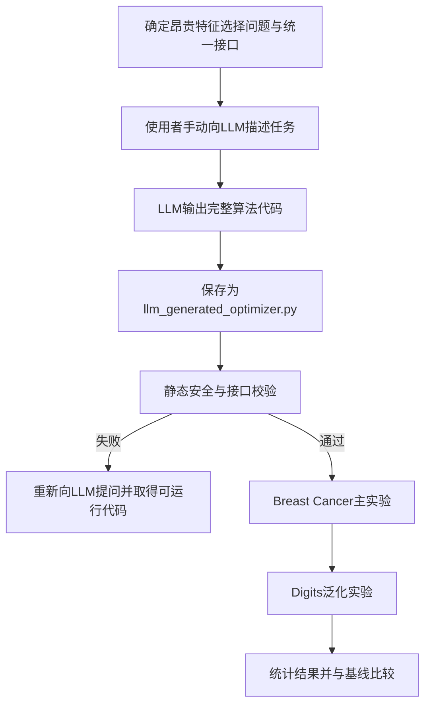
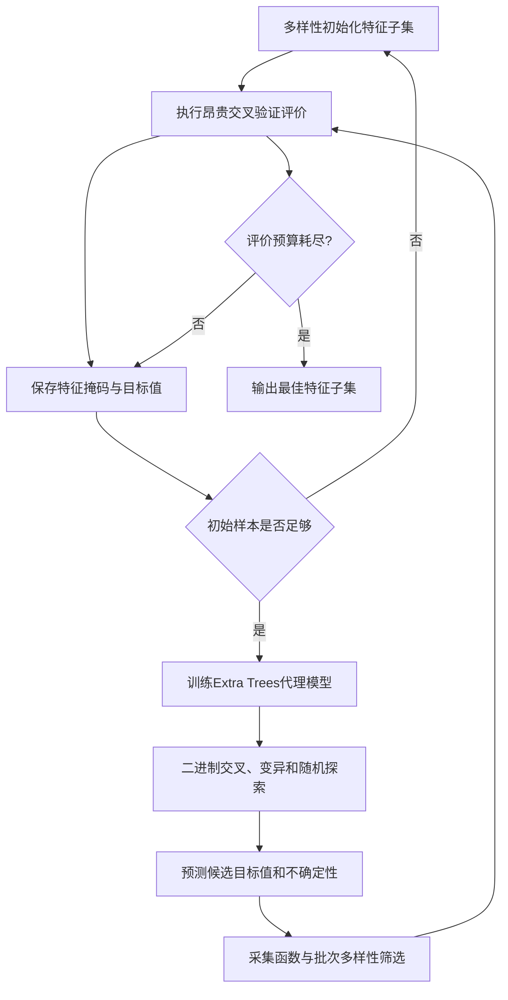

# 算法与实验说明

## 1. 任务说明

本项目研究由大语言模型设计的代理模型辅助进化算法在昂贵特征选择问题上的表现。使用者首先在LLM聊天界面中手动描述优化问题与程序接口，随后把LLM输出的算法保存到项目中。正式实验期间，算法不会调用LLM，也不会调用任何外部API。

## 2. 昂贵特征选择问题

优化变量为二进制特征掩码：

```text
x_i = 1：选择第 i 个特征
x_i = 0：不选择第 i 个特征
```

目标函数为：

```text
f(x) = 1 - CVAccuracy(x) + 0.01 × SelectedFeatureRatio(x)
```

每评价一个新特征子集，都需要重新训练支持向量机并执行分层交叉验证。Breast Cancer有30个特征，搜索空间为2^30；Digits有64个特征，搜索空间为2^64，无法进行穷举搜索。

## 3. 项目工作流程



这里只是人工取得一份可运行的LLM算法代码，不包含程序自动生成、在线调用或算法版本迭代。

## 4. LLM设计的算法

当前算法由LLM设计为代理模型辅助的自适应二进制进化算法，包含：

1. 使用不同特征密度和汉明距离进行多样性初始化；
2. 采用 Extra Trees 回归器近似昂贵目标函数；
3. 使用精英个体与历史个体进行二进制交叉；
4. 使用自适应位翻转变异产生候选特征子集；
5. 搜索停滞时提高变异强度；
6. 利用多棵树的预测差异估计代理模型不确定性；
7. 综合预测目标值、不确定性与批次多样性筛选候选解；
8. 避免重复评价已经访问过的特征子集。

## 5. 算法运行流程



## 6. 数据集

| 数据集 | 样本数 | 特征数 | 作用 |
|---|---:|---:|---|
| Breast Cancer | 569 | 30 | 主实验 |
| Digits | 1797 | 64 | 泛化验证 |

两个数据集都由scikit-learn直接加载，无需下载外部文件。

## 7. 正式实验设计

- 算法：LLM生成算法、随机搜索基线；
- 真实评价预算：每次独立运行60次；
- 独立运行：10个随机种子；
- 分类器：RBF核支持向量机；
- 评价方法：5折分层交叉验证；
- 特征惩罚系数：0.01；
- 公平性：所有优化方法使用相同的真实评价预算、数据划分和种子集合。

记录指标：

- 最终最佳目标值；
- 分类准确率；
- 选中特征数量；
- 收敛曲线；
- 不同随机运行的箱线图；
- 重复候选比例；
- 运行时间。

## 8. 结果解释

快速配置只用于验证代码是否能运行，不能作为正式统计结论。正式结论应使用10次独立运行的均值、标准差和箱线图。若LLM算法在相同真实评价预算下取得更低的目标值，说明它能够以较少的昂贵分类器训练次数找到准确率较高且特征数较少的子集。

